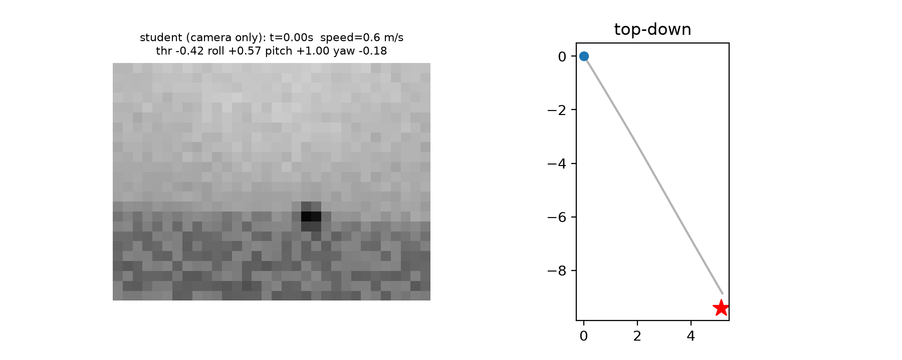
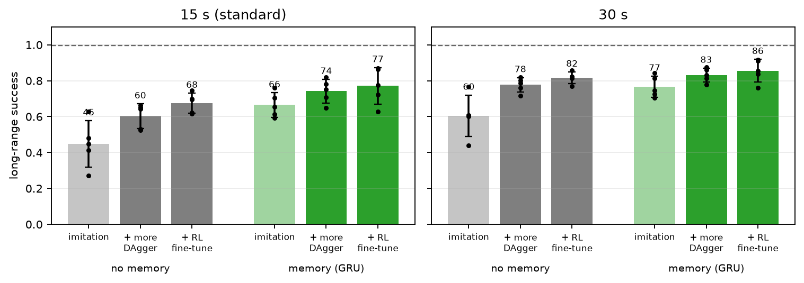
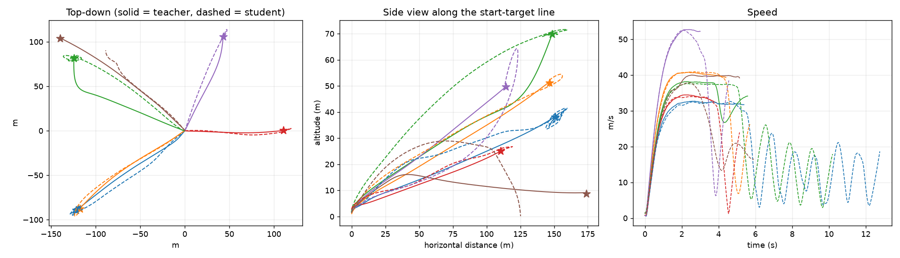
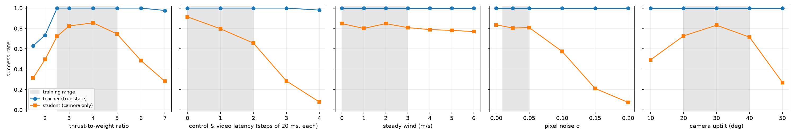
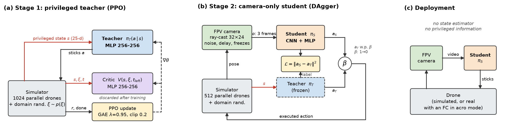
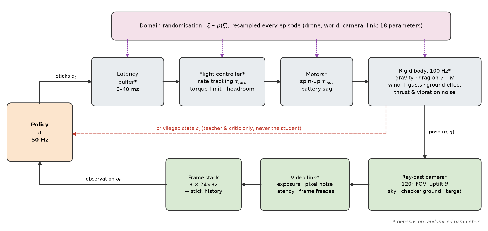

# From Pixels to Sticks: What a Camera-Only FPV Acro Pilot Needs to Learn

A simulated FPV quadrotor learns to fly to a target as fast as possible the way a
human FPV pilot does. It commands throttle and roll/pitch/yaw **rates** (acro mode)
and sees only **noisy, delayed 32×24 camera views**. It gets no position, velocity
or attitude. Every episode has a different drone, wind and camera (18 randomised
parameters). Physics, rendering, PPO, DAgger and RL fine-tuning are all written in
pure JAX and train on a laptop CPU.

🎬 **Video:** [`docs/video/fpv_rl_ral.mp4`](docs/video/fpv_rl_ral.mp4)

<p align="center"></p>

## Findings

**Long range** (targets 100–200 m away at 0–100 m altitude, a ~40 m/s drone, 1 m goal radius,
15 s limit). Camera-only students, 5 seeds, mean ± s.d.:

| | Imitation (DAgger) | + more DAgger (compute-matched) | + RL fine-tune |
|---|---|---|---|
| No memory | 44.8 ± 12.9% | 60.3 ± 6.9% | 67.5 ± 5.5% |
| **Memory (GRU)** | 66.5 ± 6.8% | 74.2 ± 6.6% | **77.2 ± 10.2%** (30 s limit: 85.6%) |

Reference points:
- A calibrated, hand-designed visual-servo pilot (no learning) reaches 3.0%.
- The state-based teachers reach 99.5% (visibility-limited) and 99.9% (all-knowing).

<p align="center"></p>

- **Memory is the robust ingredient:** it adds +21.7 points under imitation (Welch t = 3.3).
- **Training on the student's own states matters most after that:** continued DAgger
  adds +8 to +16 points (5 of 5 seeds).
- **RL fine-tuning adds a little more:** +3 to +7 points over the compute-matched control,
  in 4 of 5 seeds.
- **What the memory carries is velocity.** Linear probes, with a memoryless control,
  show that attitude and body rates are already readable from the current frames.
  Memory adds velocity (R² 0.57 → 0.79). There is no sign the student identifies the
  drone online.
- **The remaining failures are mostly search.** In 55–66% of timeouts the student never
  comes within 20 m of the target. Crashes stay around 5%.

<p align="center"></p>

**Short range** (targets 4–12 m):
- The camera-only student reaches 79.8% against the teacher's 100%. Its misses are
  near-misses, not hesitation.
- Behaviour cloning reaches only 16.4%. Dataset aggregation (DAgger) is essential.
- A perception-aware teacher reward lifts the student from 67.1% to 79.8%.
- Latency hurts far more than wind.

<p align="center"></p>

## Method

<p align="center"></p>

1. **Teacher:** PPO on the true state, with an asymmetric critic. The long-range teacher
   only knows where the target is once it has seen it.
2. **Student:** camera only. It sees a 120° wide view plus 30° and 8° views steered by its
   own gaze, plus its last stick commands. It is trained by DAgger with an aggregated
   dataset, optionally with a GRU.
3. **RL fine-tuning:** recurrent PPO on the student, with a privileged critic and a
   decaying imitation anchor.

<p align="center"></p>

The simulator models:
- control and video latency, motor lag and saturation;
- battery sag, drag, wind and gusts, ground effect;
- camera exposure, pixel noise and frame freezes;
- an area-correct sub-pixel target, so a 1 m target 200 m away is still faintly visible.

## Reproduce

```bash
uv sync
./reproduce.sh      # every run, evaluation and figure (short range ~3.5 h, long range ~2 days on an M3 CPU)
```

```
fpv/          simulator (env, camera), networks, PPO, DAgger, RL fine-tuning, visual-servo baseline
train.py      training: teacher | student | finetune
evaluate.py   short-range evaluation, robustness sweep, ablations, long-range flights
scripts/      long-range benchmark, memory probes, visual-servo baseline, video
results/      evaluation outputs behind every reported number
docs/         figures and video
```

## Citation

```bibtex
@misc{chan2026pixels,
  author = {Chan, Wee Kiat},
  title  = {From Pixels to Sticks: What a Camera-Only {FPV} Acro Pilot Needs to Learn},
  year   = {2026},
  url    = {https://github.com/cweekiat/fpv-rl-jax}
}
```

## License

**Noncommercial use only.** The code is under the
[PolyForm Noncommercial License 1.0.0](LICENSE). The figures, video and results
are under [CC BY-NC 4.0](https://creativecommons.org/licenses/by-nc/4.0/). Research,
teaching and personal use are welcome, with attribution. Commercial use needs a separate
license from the author.
